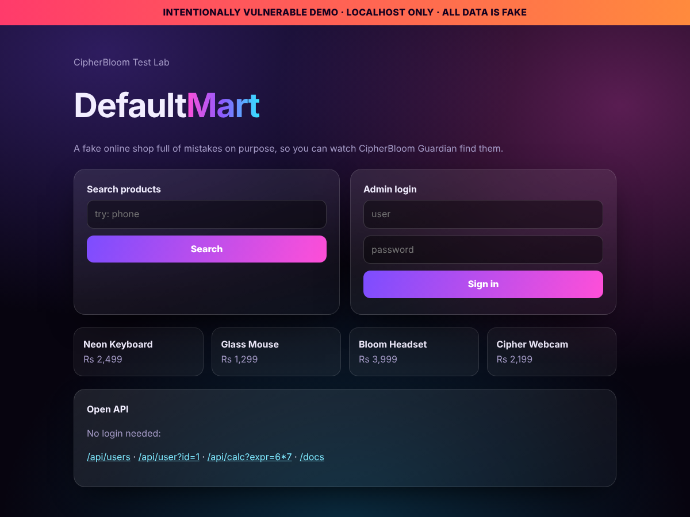

# CipherBloom Test Lab

An **intentionally vulnerable demo shop** for testing [CipherBloom Guardian](https://github.com/dev-shubh-madara/project-protector). It plants 42 kinds of mistakes (leaked keys, syntax errors, risky code, exposed files, open APIs) and shows you how many your scanner catches.

<p align="center"></p>

> **Warning: vulnerable on purpose.** Everything here is fake and the shop only runs on `127.0.0.1`. It refuses to start on any other address. **Never deploy it to a public server.**

## Quick start

You need Python 3.10+. Nothing else.

```bash
git clone https://github.com/dev-shubh-madara/test-web-project-protector
cd test-web-project-protector
pip install git+https://github.com/dev-shubh-madara/project-protector

python lab.py scoreboard
```

`scoreboard` builds the lab, starts the shop, scans it with CipherBloom Guardian and prints a PASS/MISS list. It also saves `scoreboard-report.html` for you to open.

## Test it yourself (good for a video)

```bash
python lab.py build        # creates ./target with fake secrets and broken files
python lab.py serve        # shop runs at http://127.0.0.1:8000
```

Then, in a second terminal:

```bash
cipherbloom ui
```

In the dashboard choose **Folder path** and paste the full path of the `target` folder. Switch on **Live check on localhost**, enter `http://127.0.0.1:8000`, type `I OWN THIS`, and press **Start protection scan**.

Or use the command line:

```bash
cipherbloom scan target --live http://127.0.0.1:8000 --html report.html
```

You can also open `http://127.0.0.1:8000` in a browser and click around: search, login (`admin` / `admin123`) and the open API.

## What is planted

| Area | What the shop contains |
|---|---|
| Leaked keys | Fake AWS, GitHub, Telegram, Google, Slack, Stripe, Discord and AI-provider keys, a private key header, a database URL with a password, a hard-coded secret |
| `.env` mistakes | `.env` and `.env.local` with secrets, not in `.gitignore`, no `.env.example` |
| Syntax errors | 2 Python files, 1 JSON file, 1 JavaScript file |
| Risky code | `eval`, `exec`, `shell=True`, `os.system`, `pickle`, `yaml.load`, `verify=False`, SQL built with string joins, debug mode, CORS `*`, `innerHTML`, `child_process.exec` |
| Dependencies | Unpinned Python packages, `*` and `latest` npm versions, no lock file |
| Exposed files (live) | `/.env`, `/.env.local`, `/.git/config`, `/.git/HEAD`, `/backup.zip`, `/db.sqlite3`, `/.aws/credentials`, `/docker-compose.yml`, `/.DS_Store` |
| Server settings (live) | No security headers, server version shown, CORS that trusts any site with cookies, stack trace on error pages, exposed console page, cookies without flags, public API docs |

The expected list is in [`expected.json`](expected.json).

## Why it is safe

- **Localhost only.** The server exits if you try `--host 0.0.0.0` or any non-local address.
- **No real attacks possible.** `legacy_tools.py` and `server_old.js` are never run by the shop. The `/api/calc` endpoint only accepts plain arithmetic, `/api/user` reads a database holding three fake people, and the "console" and "stack trace" pages are just text.
- **Fake secrets, generated locally.** `python lab.py build` makes random keys in the right formats on your computer. They are not stored in this repo, which keeps GitHub's secret blocker quiet and keeps the repo clean.
- **Broken files are templates.** The syntax errors live in `templates/*.tpl`, so this repo's own CI and scanners stay green.

## Commands

| Command | What it does |
|---|---|
| `python lab.py build [--seed N]` | Create `./target` (same seed = same fake secrets) |
| `python lab.py serve [--port 8000]` | Run the shop on localhost |
| `python lab.py scoreboard [--port 8000] [--guardian PATH]` | Build, run, scan and show PASS/MISS |
| `python lab.py clean` | Delete `./target` |

## Known limits

- It checks only what CipherBloom Guardian v0.1 is built to find. If you add a new rule to Guardian, add a matching line to `expected.json` and a planted example in `templates/`.
- The code locations shown for live findings are best guesses, so treat them as hints.

MIT licensed.
